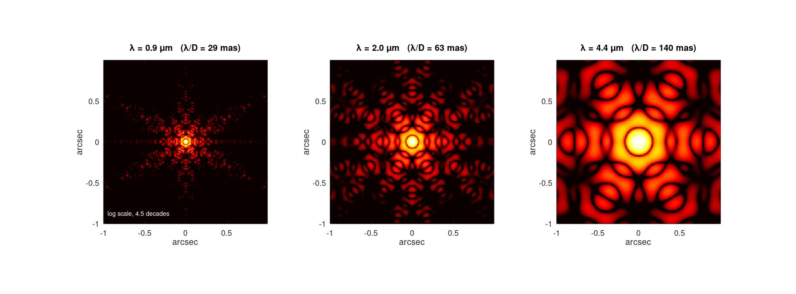
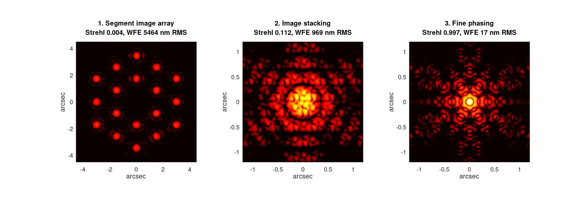
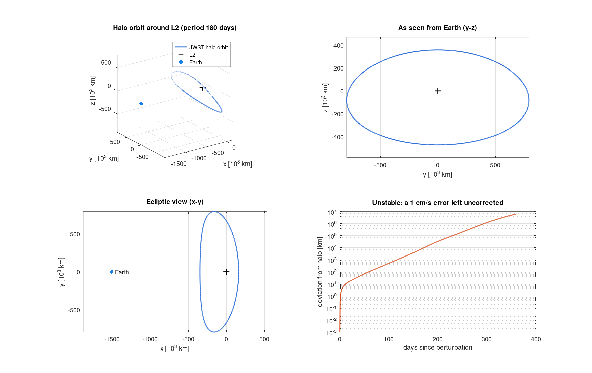
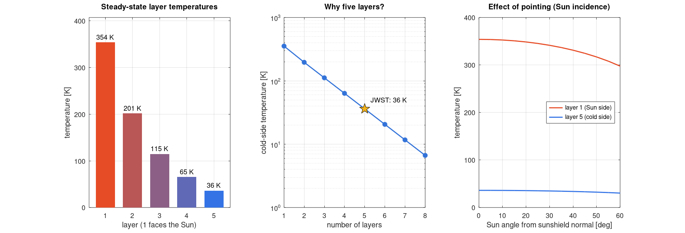

# JWST in MATLAB

Physics simulations of the **James Webb Space Telescope** written in plain
MATLAB. Each demo takes one part of the observatory, models it from first
principles, and produces a figure:

| Demo | What it models |
| --- | --- |
| `demo_mirror_psf` | The 18-segment hexagonal primary mirror and its point-spread function (the eight-pointed JWST star) at 0.9, 2.0 and 4.4 µm |
| `demo_segment_alignment` | Mirror commissioning: 18 separate star images, then stacking, then fine phasing into one diffraction-limited image |
| `demo_wavefront_error` | Monte Carlo of segment piston errors against Strehl ratio, compared with the Maréchal approximation and the 150 nm error budget |
| `demo_l2_halo_orbit` | Locating Sun–Earth L2 and computing JWST's ~180-day halo orbit in the circular restricted three-body problem, plus why it needs station-keeping |
| `demo_sunshield_thermal` | Radiative balance of the five-layer sunshield: from ~354 K on the Sun side to ~36 K on the cold side |
| `demo_why_infrared` | Blackbody spectra, JWST vs. Hubble resolution, and how the Lyman break of distant galaxies is redshifted into NIRCam filters |






## Running it

Requirements: **MATLAB R2019b or newer** with no toolboxes, or **GNU Octave 7+**.

```matlab
>> cd path/to/this/repo
>> startup      % adds src/, demos/ and tests/ to the path (MATLAB runs this automatically)
>> run_all      % runs every demo and writes PNGs to output/
>> demo_l2_halo_orbit   % or run any single demo
>> run_tests    % 12 self-checking tests
```

Running from a terminal with Octave, without opening figure windows:

```bash
JWST_HEADLESS=1 octave --no-gui run_all.m
JWST_HEADLESS=1 octave --no-gui --eval "addpath('tests'); exit(~run_tests())"
```

All demos together take about 15 seconds.

## Project layout

```
startup.m                 path setup
run_all.m                 runs every demo
demos/                    one script per topic (the figures above)
src/jwst_constants.m      telescope and mission constants
src/mirror/               segment layout and sampled entrance pupil
src/optics/               segment wavefront errors, FFT and matrix-Fourier PSFs
src/orbit/                CR3BP dynamics, L2, Richardson halo guess, differential correction
src/thermal/              multi-layer sunshield energy balance
src/science/              Planck function, NIRCam filters, Lyman-break dropouts
src/util/                 figure helpers
tests/run_tests.m         test suite (plain asserts, works in MATLAB and Octave)
docs/figures/             sample output
```

## The models, briefly

**Optics.** The pupil is 18 flat-topped hexagons (1.32 m flat-to-flat, 7 mm
gaps) in two rings, with the secondary mirror obscuration and three support
struts. The PSF is the squared modulus of the Fourier transform of the pupil
field `mask .* exp(2πi·OPD/λ)`, normalised so a perfect mirror has Strehl 1.
`jwst_psf` uses a zero-padded FFT; `jwst_psf_mft` evaluates the same integral
as a matrix product over a chosen field of view, which samples small fields
finely without a huge FFT. The idealised geometry gives 26.6 m² of collecting
area versus the official ~25.4 m², which also accounts for segment edge losses.

**Orbit.** The Sun and the Earth–Moon barycentre move on circular orbits
(circular restricted three-body problem, mass ratio μ ≈ 3.04×10⁻⁶). L2 comes from
the standard quintic in its distance beyond Earth. A halo orbit starts from
Richardson's third-order analytic approximation and is refined by
differential correction using the state transition matrix until the
trajectory crosses the x–z plane perpendicularly. The largest eigenvalue of
the monodromy matrix (~1300 per revolution) shows that errors grow e-fold
roughly every 25 days, consistent with JWST's station-keeping burns about
every three weeks.

**Sunshield.** Each membrane is a grey body. Adjacent layers exchange heat as
parallel plates with low-emissivity aluminised faces, but only a fraction
(`coupling`, 0.34 by default) of radiation from an inner face reaches the
next layer; the rest escapes through the open edges. Because the energy
balance is linear in T⁴, it is solved directly. This is a one-dimensional
teaching model tuned to JWST's published hot and cold temperatures, not a
reproduction of the flight thermal model.

**Science.** Planck spectra show why a cold telescope is needed in the
infrared. The Lyman break at 121.6 nm × (1 + z) identifies which NIRCam
filters a high-redshift galaxy disappears from (for example, a z = 12 galaxy
is invisible in F115W and visible in F200W).

Filter edges and several constants are rounded public values, good for
teaching and quick estimates, not for proposal planning.
